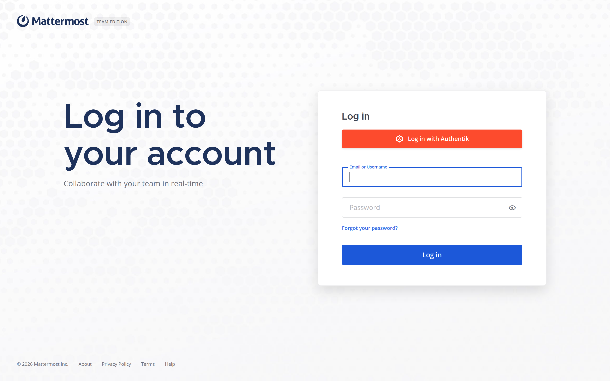
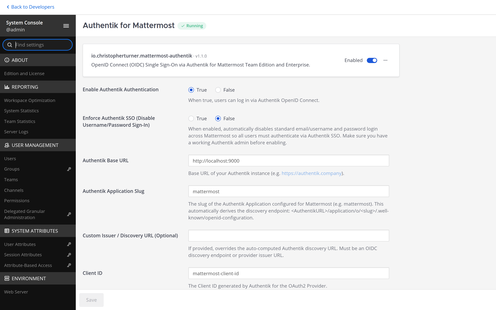
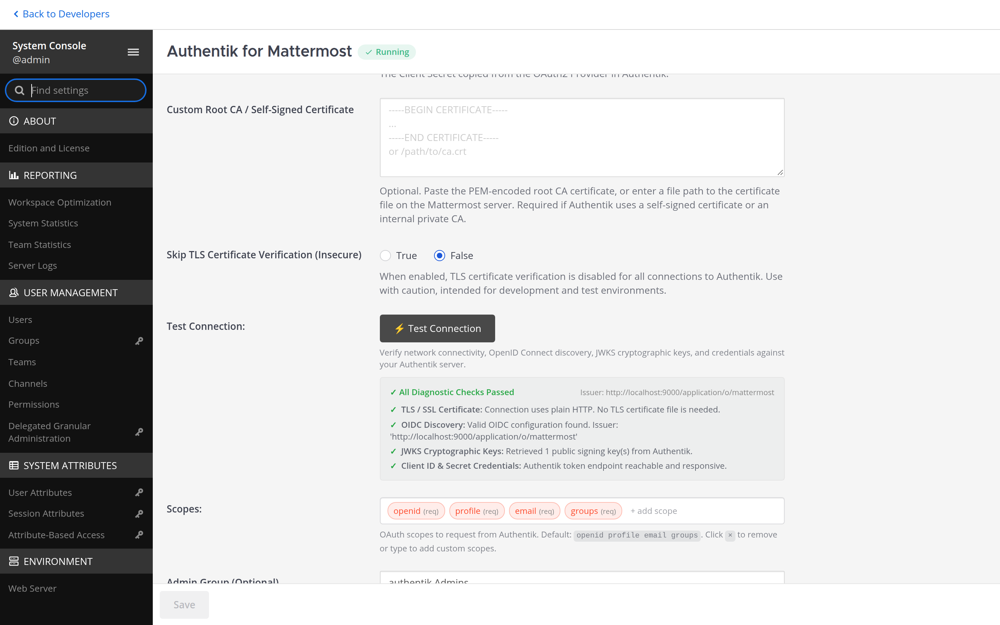
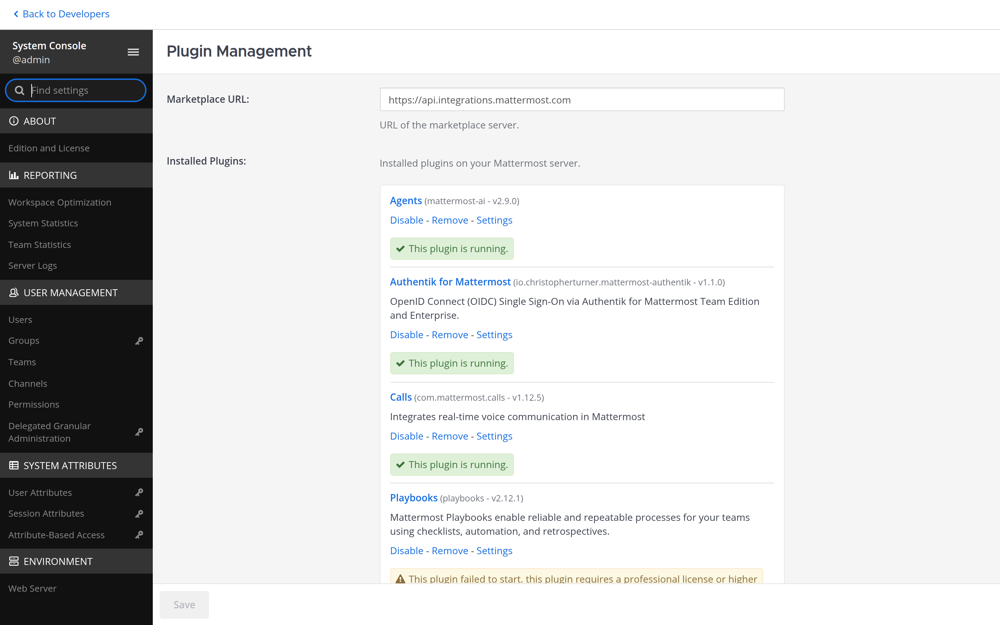
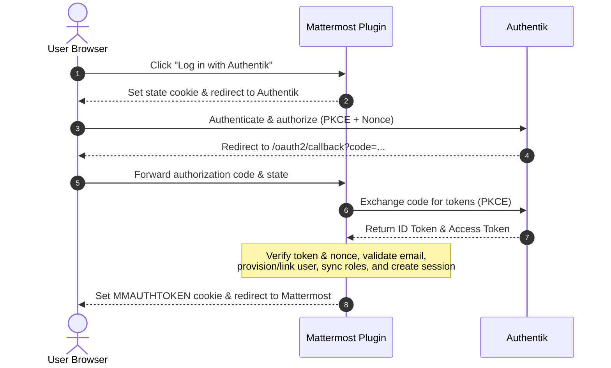

# Authentik for Mattermost

[](LICENSE)
[-blue)](https://mattermost.com)
[](https://mattermost.com)
[-fd4b2d)](https://goauthentik.io)

> **Disclaimer:** **Authentik for Mattermost** is an independent, third-party plugin developed by [Christopher Turner](https://christopherturner.io). It is not affiliated with, sponsored by, or endorsed by Mattermost, Inc. or Authentik (Authentik Security Inc.). Authentik, the Authentik logo/icon, and related marks are trademarks or registered trademarks of Authentik Security Inc. and are used solely for identification and compatibility purposes.

An OpenID Connect (OIDC) Single Sign-On (SSO) plugin for **Mattermost** integrating directly with **Authentik**.

Designed to provide native Authentik authentication across **both Mattermost Team Edition and Enterprise**. Fully tested and verified end-to-end on **Mattermost v10.5, v11.11, and v12.1** (including React 19 webapp architecture) and **Authentik 2026.8+** (official server and worker).

### Project Resources
- **Project Homepage & Documentation:** [https://mattermost-authentik.christopherturner.io/](https://mattermost-authentik.christopherturner.io/)
- **Source Code Repository:** [https://github.com/christopherturner/mattermost-authentik](https://github.com/christopherturner/mattermost-authentik)
- **Issue Tracker:** [https://github.com/christopherturner/mattermost-authentik/issues](https://github.com/christopherturner/mattermost-authentik/issues)
- **Changelog:** [CHANGELOG.md](CHANGELOG.md)

### Compatibility
- **Mattermost:** `v10.5.0`, `v11.11.0`, `v12.1.0` (Team Edition and Enterprise)
- **Authentik:** Verified with Authentik `2026.8.x`+ (and any standard OpenID Connect 1.0 provider supporting Authorization Code Flow with PKCE and discovery)

---

## Features

- **Full Edition Support (Team & Enterprise):** Implements the OpenID Connect (OIDC) Authorization Code Flow natively via Mattermost's Plugin API, providing seamless SSO functionality across both Team Edition and Enterprise environments.
- **Mattermost v12+ & React 19 Ready:** Built for Mattermost's modern web client, with zero legacy React deprecation issues and fallback DOM observers for custom login layouts.
- **Authentik Application Auto-Discovery:** Point the plugin at your Authentik Base URL and Application Slug, and it automatically discovers endpoints via `.well-known/openid-configuration`.
- **Authentik Group & Role Synchronization:** Map an Authentik group (e.g. `authentik Admins` or `mattermost-admins`) directly to Mattermost **System Administrator** privileges. Roles are dynamically granted or revoked upon login.
- **Account Auto-Creation & Linking:**
  - Auto-provisions new users with sanitized usernames, email, and full name.
  - Automatically links existing email/password or GitLab accounts to Authentik seamlessly on first login (with verified-email enforcement).
- **Default Team Auto-Join:** Automatically enrolls newly provisioned users into a designated team (e.g. `main` or `engineering`).
- **Enterprise-Grade Security:**
  - **PKCE (RFC 7636) with SHA-256 (`S256`)** code challenge.
  - **OIDC Nonce** verification to mitigate token replay attacks.
  - **HMAC-signed State Tokens** stored in KV store with strict 10-minute expiry and atomic consumption (`KVCompareAndDelete`).
  - **Browser-bound State Cookie (`MMAUTHENTIKSTATE`)** preventing login CSRF.
  - **Standard Session Cookies:** Correctly sets `MMAUTHTOKEN`, `MMUSERID`, and `MMCSRF` matching Mattermost core session lifetime and subdomain settings.
  - **Verified Email Enforcement:** Auto-linking and logins enforce verified email confirmation from Authentik to prevent account takeover.
  - **Server-Side SSO Enforcement:** Blocks standard password logins at the API layer via Mattermost's `UserWillLogIn` hook when SSO enforcement is active, with optional automatic login page redirection (`?no_sso=1` bypass).
  - **Single Logout (OIDC SLO):** Optional RP-initiated logout (`end_session_endpoint`) and OIDC Back-Channel Logout (`/oauth2/backchannel-logout`) session revocation.
  - **Transport Security Validation:** Strict issuer validation rejecting non-loopback cleartext HTTP URLs.
- **Desktop & Mobile App Support:**
  - Handles the Mattermost Desktop App (Electron) using a popup flow with `localStorage` cross-window event synchronization (bypassing Cross-Origin Opener Policy / COOP navigation blocks).
  - Supports deep-linking redirects for native mobile clients (`mmauth://callback`).
- **Authentik Branding:** Customizable button text and brand styling (defaulting to Authentik orange `#FD4B2D` with official SVG icon).

---

## Screenshots

| Mattermost Sign-In with Authentik SSO | Plugin Settings & SSO Configuration |
|---|---|
|  |  |

| Real-Time Connection Diagnostics & Dynamic Scopes | System Console Plugin Management |
|---|---|
|  |  |

---

## Architecture Overview



---

## 1. Authentik Setup

### Step 1: Create an OAuth2/OpenID Provider
1. Log in to your Authentik Administration interface.
2. Navigate to **Applications** > **Providers** and click **Create**.
3. Select **OAuth2/OpenID Provider** and click **Next**.
4. Configure the following fields:
   - **Name:** `Mattermost Provider`
   - **Authorization flow:** Choose your authorization flow (e.g. `default-provider-authorization-explicit-consent` or your standard login flow).
   - **Client type:** `Confidential`
   - **Client ID:** *(Generate or keep default; copy this for Mattermost)*
   - **Client Secret:** *(Generate or keep default; copy this for Mattermost)*
   - **Redirect URIs (Strict):**
     ```text
     https://mattermost.company/plugins/io.christopherturner.mattermost-authentik/oauth2/callback
     ```
     *(Replace `mattermost.company` with your actual Mattermost domain)*
   - **Signing Key:** Select your Authentik self-signed or Let's Encrypt certificate.
   - **Scopes:** Ensure `openid`, `email`, and `profile` are selected.
   - **Subject mode:** `Based on the User's hashed ID` or `Based on the User's username` (default hashed ID recommended).
5. Click **Finish**.

### Step 2: Create an Application in Authentik
1. Navigate to **Applications** > **Applications** and click **Create**.
2. Configure:
   - **Name:** `Mattermost`
   - **Slug:** `mattermost` *(Important: note this slug if you customize it)*
   - **Provider:** Select `Mattermost Provider` created in Step 1.
3. Click **Create**.

> **Note on Admin Groups:** If you want to automatically grant Mattermost System Admin to an Authentik group (e.g. `authentik Admins`), ensure that group exists in Authentik under **Directory** > **Groups** and has members assigned. Authentik includes the user's groups in the `groups` claim by default with the `profile` scope.

---

## 2. Mattermost Installation & Configuration

### Prerequisites
In your Mattermost server configuration (`config.json` or Environment Variables), verify that plugin uploads are enabled:
```json
"PluginSettings": {
    "Enable": true,
    "EnableUploads": true
}
```
Or via environment variable:
```bash
MM_PLUGINSETTINGS_ENABLEUPLOADS=true
```

### Step 1: Upload the Plugin Bundle
1. In the release assets or your `dist/` directory, locate:
   ```text
   io.christopherturner.mattermost-authentik-1.3.0.tar.gz
   ```
2. In Mattermost, go to **System Console** > **Plugins** > **Plugin Management**.
3. Under **Upload Plugin**, choose the `.tar.gz` bundle and click **Upload**.
4. In the list of installed plugins, locate **Authentik for Mattermost** and click **Enable**.

### Step 2: Configure Plugin Settings
In the System Console, navigate to **Plugins** > **Authentik for Mattermost** in the left sidebar:

| Setting | Value / Example | Description |
|---|---|---|
| **Enable Authentik Authentication** | `true` | Turn the SSO integration on/off. |
| **Enforce Authentik SSO (Disable Username/Password Sign-In)** | `false` | When enabled, automatically disables standard email/password login across Mattermost so all users must authenticate via Authentik SSO. Make sure you have a working Authentik admin before enabling. |
| **Auto-Redirect to Authentik on Login** | `false` | When enabled alongside **Enforce Authentik SSO**, automatically redirects browser users from `/login` to Authentik without a button click (append `?no_sso=1` to bypass). |
| **Enable Single Logout (OIDC SLO)** | `false` | When enabled, signing out of Mattermost redirects Authentik users to Authentik's `end_session_endpoint`, and Back-Channel Logout requests revoke active Mattermost sessions. |
| **Authentik Integration URLs** | *(Copy helper)* | Displays and one-click copies the OAuth2 Callback Redirect URI and Back-Channel Logout URI for Authentik configuration. |
| **Authentik Base URL** | `https://authentik.company` | Base URL of your Authentik instance. |
| **Authentik Application Slug** | `mattermost` | Matches the slug configured in Authentik (used to discover OIDC endpoints). |
| **Custom Issuer / Discovery URL (Optional)** | *(Leave blank)* | Optional override if using a non-standard OIDC endpoint. |
| **Client ID** | *(Paste from Authentik)* | Client ID from the Authentik Provider. |
| **Client Secret** | *(Paste from Authentik)* | Client Secret from the Authentik Provider. |
| **Custom Root CA / Self-Signed Certificate** | *(Optional)* | Paste PEM-encoded certificate or specify a certificate file path on the Mattermost server. Required if Authentik uses a self-signed or internal CA. |
| **Skip TLS Certificate Verification (Insecure)** | `false` | Disables TLS certificate verification (for development/testing only). |
| **Test Connection & Credentials** | *(Button)* | Interactive diagnostic tool verifying connectivity, certificates, OIDC discovery, JWKS keys, and Client ID / Secret. |
| **Scopes** | `openid profile email groups` | OAuth scopes to request (interactive pill selector). `openid`, `profile`, `email`, and `groups` are required. |
| **Admin Group (Optional)** | `mattermost-admins` | Custom Authentik group name(s). Members automatically receive System Admin in Mattermost. Supports comma-separated groups (e.g. `mattermost-admins, it-ops`). |
| **Grant System Admin to 'authentik Admins'** | `true` | When enabled, members of Authentik's default `authentik Admins` group automatically receive System Admin in Mattermost. |
| **Synchronize Admin Role** | `true` | Automatically grant/revoke System Admin on login based on group membership. |
| **Default Team Handle (Optional)** | `main` | Team handle (e.g. `company` or `engineering`) to auto-join new users. |
| **Auto-Create Accounts** | `true` | Automatically provisions accounts for new users. |
| **Auto-Link Existing Accounts by Email**| `true` | Links existing Mattermost users with matching email addresses. |
| **Require Verified Email** | `true` | When `true`, logins will be rejected if Authentik reports that the user's email address has not been verified. |
| **Login Button Text** | `Log in with Authentik` | Text displayed on the login button. |
| **Login Button Color** | `#FD4B2D` | Button background color (Authentik brand color). |
| **Manage Legacy LDAP Accounts** | *(Action buttons)* | Tool to view, unlock, or deactivate leftover LDAP accounts so they can link to Authentik. |

Click **Save**. Users will immediately see the **"Log in with Authentik"** button on the Mattermost login page!

---

## 3. Building From Source

### Requirements
- **Go** 1.22+
- **Node.js** 18+ and **npm**
- **make**
- *(Optional)* **Docker**

### Standard Build
Clone the repository and run:
```bash
# Run tests
make test

# Run linter and vulnerability scanner
make lint

# Verify tests, linting, and build in one step
make check

# Build server binaries, webapp bundle, and package .tar.gz
make bundle
```
The compiled bundle will be available at:
```text
dist/io.christopherturner.mattermost-authentik-1.3.0.tar.gz
```

### Docker Build (No local Go/Node required)
You can also compile the plugin in an isolated container:
```bash
docker build -o dist .
```

### Direct CLI Deployment
If you have a development Mattermost instance running:
```bash
export MM_SERVICESETTINGS_SITEURL="https://mattermost.company"
export MM_ADMIN_TOKEN="your-admin-access-token"
make deploy
```

---

## 4. Troubleshooting & FAQ

### Does this require an Enterprise or Professional license?
**No.** Mattermost Team Edition allows full execution of plugins. While native OIDC in the core server settings (`OpenIdSettings`) requires an Enterprise license, this plugin provides its own complete OIDC implementation via the official Plugin API (`plugin.API.CreateSession`, `CreateUser`, etc.).

### Why do I get "Authentik login rejected: email not verified"?
In version 1.2.0+, `RequireEmailVerified` defaults to `true` to prevent account takeover via unverified third-party emails. If your Authentik OAuth2 Scope Mapping does not include an explicit `email_verified` claim, Authentik may report `email_verified: false`. In Authentik:
1. Navigate to **Customization** > **Property Mappings**.
2. Locate or create an OpenID Scope Mapping for `email` and ensure `email_verified` reflects your directory's verification state (if your Authentik directory strictly contains verified emails, you can return `return {"email": request.user.email, "email_verified": True}`).
3. Alternatively, if your email setup does not verify addresses, you can toggle **Require Verified Email** to `false` in the System Console.

### How do I configure Self-Signed TLS or Custom CA Certificates?
If your Authentik instance uses a private CA or self-signed certificate:
1. In the Mattermost System Console, navigate to **Plugins** > **Authentik for Mattermost**.
2. Under **Custom Root CA Certificate**, either paste the full PEM-encoded certificate text (including `-----BEGIN CERTIFICATE-----` and `-----END CERTIFICATE-----`), or specify the absolute container path to the `.pem` or `.crt` file (e.g. `/certs/authentik-ca.pem`).
3. Click **Diagnose Connection** to empirically verify the TLS handshake before saving.

### How are existing accounts linked?
When **Auto-Link Existing Accounts by Email** is enabled, an existing user logging in with Authentik for the first time will have their Mattermost `AuthService` set to `authentik` and mapped to their Authentik `sub`. Their existing channels, messages, and settings remain untouched.

### Does it work with the Mattermost Desktop App?
**Yes.** The Mattermost Desktop app (Electron) uses a specialized popup flow. The plugin opens the Authentik authentication dialog in a secondary window and synchronizes the session token back to the primary window via a secure Same-Origin `localStorage` broadcast.

### How do I configure HTTPS behind a Reverse Proxy?
Ensure your reverse proxy (Nginx, Traefik, Caddy, etc.) forwards the following headers to Mattermost:
- `X-Forwarded-Proto https`
- `X-Forwarded-For $remote_addr`
- `Host $host`

In Mattermost, ensure **Site URL** in **System Console** > **Environment** > **Web Server** is set to your public HTTPS URL (e.g. `https://mattermost.company`).

---

## Links & Community

- **Project Homepage:** [https://mattermost-authentik.christopherturner.io/](https://mattermost-authentik.christopherturner.io/)
- **Repository:** [https://github.com/christopherturner/mattermost-authentik](https://github.com/christopherturner/mattermost-authentik)
- **Issue Tracker:** [https://github.com/christopherturner/mattermost-authentik/issues](https://github.com/christopherturner/mattermost-authentik/issues)
- **Changelog:** [CHANGELOG.md](CHANGELOG.md)

---

## License

This project is licensed under the MIT License - see the [LICENSE](LICENSE) file for details.

---

## Disclaimer

> **Disclaimer:** Authentik for Mattermost is an independent, third-party project developed by Christopher Turner (https://christopherturner.io). It is not affiliated with, sponsored by, or endorsed by Mattermost, Inc. or Authentik (Authentik Security Inc. / goauthentik.io). Mattermost is a registered trademark of Mattermost, Inc. All Authentik product names, references, trademarks, and logos/icons (including `assets/authentik-icon.svg`) are the property of Authentik (Authentik Security Inc.) and are used herein under nominative fair use to indicate interoperability and integration.
